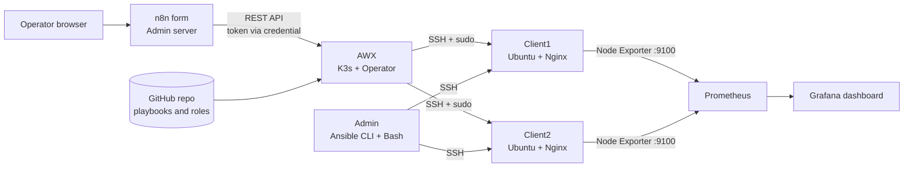

# Linux Client Administration & Automation Lab

A hands-on lab that manages Ubuntu Linux clients from one Admin machine, growing from manual SSH administration to **Ansible roles**, **Debian packaging**, **Bash automation**, an **n8n + AWX self-service portal** and **Prometheus + Grafana monitoring**. Built on AWS EC2 instances (one Admin/automation host, one AWX host, two Ubuntu clients).

> This repository holds the Ansible code (inventory, playbooks, roles) that AWX pulls from, plus the scripts, packaging sources and documentation for the rest of the lab.

## What it demonstrates
- Linux client administration over SSH key authentication
- Ansible: inventory, group/host variables, roles, handlers, templates, tags, idempotency
- Software deployment and lifecycle with `apt` and custom `.deb` packages (dependencies, `postinst`, upgrade, downgrade, removal)
- Bash automation: health reports, threshold warnings, automatic service recovery, log collection
- Security baseline checks (SSH config, `.ssh` permissions) and least-privilege sudo
- Self-service operations: n8n form → AWX REST API → Ansible → result page
- Monitoring and visualization with Node Exporter, Prometheus and Grafana

## Architecture



## Tech stack
Ubuntu Linux, AWS EC2, SSH, Bash, Ansible, AWX (K3s), n8n (Docker), Debian packaging (`dpkg-deb`), systemd, Nginx, Prometheus, Node Exporter, Grafana, Git/GitHub.

## Repository structure
```
.
├── site.yml                  # Master playbook: applies all roles to the clients group
├── health_check.yml          # Health check playbook (used by an AWX job template)
├── nginx_recovery.yml        # Automatic Nginx recovery (used by an AWX job template)
├── diagnostics.yml           # Connectivity, failed services and error-log diagnostics
├── nginx_setup.yml           # Nginx install and configure
├── nginx_stop.yml            # Stop Nginx (used for failure tests)
├── varaiable_demo.yml        # Variable precedence demo
├── inventory.ini             # Client1, Client2 (private addresses of the lab VPC)
├── group_vars/clients.yml    # Shared thresholds
├── host_vars/Client1.yml     # Per-host override
├── roles/
│   ├── users/                # Users and groups
│   ├── nginx/                # Nginx install, config template, handlers
│   ├── shared_folder/        # Shared directory and permissions
│   ├── software_deployment/  # Versioned .deb deployment (2.0 / 3.0)
│   ├── health_check/         # CLIENT HEALTH SUMMARY report
│   └── security_compliance/  # SSH and permission compliance checks
├── scripts/
│   ├── software_deploy.sh    # Remote install / remove / upgrade over SSH
│   └── client_check.sh       # Report, warnings, auto-recovery, log collection
├── packaging/                # Source trees for custom .deb packages
├── monitoring/               # Prometheus scrape example
└── docs/                     # Step-by-step write-ups (see below)
```

## Roles
| Role | Purpose |
|---|---|
| `users` | Creates users and groups |
| `nginx` | Installs Nginx, renders a landing page from a Jinja2 template, restarts through handlers |
| `shared_folder` | Creates a shared directory with controlled permissions |
| `software_deployment` | Installs a versioned `.deb`, with `present`/`absent` state and version selection |
| `health_check` | Collects Nginx state, port 80, disk, memory, package and failed services into one summary |
| `security_compliance` | Checks effective `sshd` settings, fixes `.ssh` permissions and reports COMPLIANT / WARNING |

## Quick start
```bash
# Edit inventory.ini first: set your own client addresses, user and key path
ansible clients -i inventory.ini -m ping

ansible-playbook -i inventory.ini site.yml --syntax-check
ansible-playbook -i inventory.ini site.yml --check
ansible-playbook -i inventory.ini site.yml

ansible-playbook -i inventory.ini site.yml --tags nginx             # one role
ansible-playbook -i inventory.ini health_check.yml --limit Client1   # one host
ansible-playbook -i inventory.ini nginx_recovery.yml --limit Client1
```
Deploy a specific package version:
```bash
ansible-playbook -i inventory.ini site.yml --tags software -e client_info_version=3.0
ansible-playbook -i inventory.ini site.yml --tags software -e client_info_state=absent
```

## Documentation
| # | Topic |
|---|---|
| 1 | [Linux administration and Ansible](docs/01-linux-administration-and-ansible.md) |
| 2 | [Software packaging and deployment](docs/02-software-packaging-and-deployment.md) |
| 3 | [Client check automation script](docs/03-client-check-script.md) |
| 4 | [n8n operator portal](docs/04-n8n-operator-portal.md) |
| 5 | [AWX + n8n self-service portal](docs/05-awx-n8n-self-service-portal.md) |
| 6 | [Monitoring with Prometheus and Grafana](docs/06-monitoring-prometheus-grafana.md) |

## Key lessons
- A health check must not trust a flag that was disabled on purpose. Port checks use the TCP return code (`rc`), not `.failed` (see doc 5).
- Terminal SSH working does not mean automation works. Passphrase-protected keys and `ssh-agent` behave differently in unattended jobs (doc 4).
- Poll an AWX job by its job ID, launch it once, and keep the template ID separate from the job ID (doc 5).
- Keep monitoring (detect) and automation (repair) as separate layers (doc 6).
- Use `git revert` rather than rewriting pushed history when undoing a test change.

## Security notes
- No private keys, tokens or passwords are stored here. `.gitignore` excludes keys, `.env` files, logs and vault passwords.
- Addresses in `inventory.ini` are private VPC addresses of a lab. Replace them with your own.
- Restrict the AWX NodePort, n8n (5678), Grafana (3000) and SSH by source address. Never open them to `0.0.0.0/0`.
- Use a dedicated low-privilege AWX user for API access and a sudo allow-list for automation accounts.

## Possible improvements
Ansible Vault for secrets, Alertmanager rules, TLS in front of n8n, AWX workflow templates and approvals, input validation for the free-text package field, CI linting with `ansible-lint`.

## Author
Abid Agha
