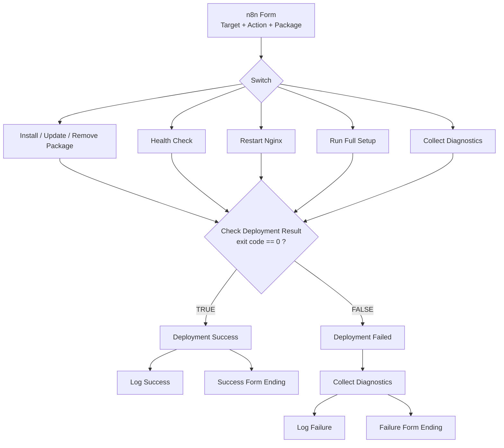

# 4. n8n operator portal on top of Ansible

After Ansible worked from the terminal, **n8n** was added as a simple form so an operator can choose a target and an action without typing Ansible syntax. n8n runs on the Admin server and executes Ansible there.



## Form
| Field | Values |
|---|---|
| Target | Client1, Client2, All Clients |
| Action | Install Package, Health Check, Update Package, Remove Package, Restart Nginx, Run Full Setup, Collect Diagnostics |
| Package | Text such as `nginx`, `curl`, `htop` (when relevant) |

## Commands built by the n8n expressions
`All Clients` maps to the `clients` group, otherwise the selected host alias is used.

```bash
# Install / update / remove
ansible <target> -i inventory.ini -b -m apt -a "name=<pkg> state=present update_cache=yes"
ansible <target> -i inventory.ini -b -m apt -a "name=<pkg> state=latest update_cache=yes"
ansible <target> -i inventory.ini -b -m apt -a "name=<pkg> state=absent"

# Restart Nginx
ansible <target> -i inventory.ini -b -m service -a "name=nginx state=restarted"

# Full setup
ansible-playbook -i inventory.ini <playbook> --limit <target>

# Diagnostics: connectivity, failed services, recent errors
ansible <target> -i inventory.ini -m ping
ansible <target> -i inventory.ini -b -m command -a "systemctl --failed"
ansible <target> -i inventory.ini -b -m command -a "journalctl -p err -n 20 --no-pager"
```

## Success and failure handling
Every action ends in an IF node, *Check Deployment Result*, which compares the command's exit code with `0` (as a **Number**). Success is shown to the operator and logged. Failure runs the diagnostics automatically, shows a failure result and logs it. The failure path was tested on purpose by pointing Client1 in the inventory at an unreachable address: Ansible reported a "No route to host" error, diagnostics still ran against Client2, and the correct address was restored afterwards.

## Audit log
Each action is appended to `automation.log` as one CSV line, for example `2026-09-10 10:15:00,Client1,Health Check,N/A,SUCCESS,0`. (`*.log` is in `.gitignore`.)

## Problems solved

| Problem | Cause and fix |
|---|---|
| Terminal SSH worked, n8n failed | The key had a passphrase and the interactive shell used `ssh-agent`. Reproduced with `SSH_AUTH_SOCK= ssh -o IdentityAgent=none -o BatchMode=yes ...`, then created a dedicated automation key without a passphrase |
| Host verification blocked automation | `known_hosts` was not prepared for the n8n user. Added the client host keys |
| Diagnostics: "ansible: command not found" | Stray backslashes changed shell parsing. Used normal command separators |
| IF node type error | The exit code was compared as a string. Changed the condition to Number |
| Health check showed the Admin hostname | The local shell expanded the command before Ansible ran it. Fixed the quoting |
| Health fields showed N/A | The parser expected an old output format. Kept command output and parser in sync |
| Form ending disappeared | The logging node sat in the form-response path. Made logging a parallel branch |
| Needed to prove the failure path | Used an unreachable client address, then restored it |

## Security notes
- Do not commit the private key or any n8n secrets.
- Validate or allow-list the package name before it goes into a shell command. Free text in a form is an injection risk.
- Use a dedicated automation account with least privilege.
- Keep the failing command's exit code before running diagnostics, otherwise the failure log may record the diagnostics' exit code.
