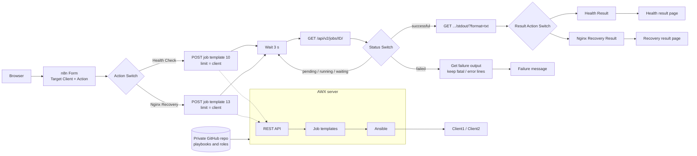

# 5. AWX + n8n self-service portal

This part replaced "n8n runs Ansible directly" with a more controlled design: **n8n calls the AWX REST API**, AWX runs the Ansible job templates, and n8n polls the job and shows a result page. It was built as 60 small tasks (63 to 122). It starts after AWX, its inventory, credentials, job templates, RBAC and the Git-backed project already existed.

## Architecture



| Component | Role |
|---|---|
| n8n (Docker on the Admin server) | Form, routing, AWX API calls, polling, output parsing, result pages |
| AWX (K3s + AWX Operator) | API, RBAC, inventory, credentials, project sync, controlled job execution |
| Ansible | Runs the health check and the Nginx recovery on the clients |
| Private GitHub repo (this one) | Source of truth for playbooks and roles. AWX reads from it |
| Client1 / Client2 | Managed Ubuntu endpoints |

## Key design decisions
- **Prompt on launch for the limit.** One job template serves every client. n8n only sends `{"limit": "<selected client>"}` and AWX still enforces the inventory and RBAC.
- **Launch once, poll the job.** The launch response is a snapshot that returns a job ID. n8n loops *Wait → Check status → Switch* until the job is `successful` or `failed`. The launch node sits outside the loop, so only one job is created.
- **Template ID vs job ID.** The template ID (10 = Linux Client Health Check, 13 = Nginx Automatic Recovery) is fixed configuration. The job ID changes every run.
- **Least privilege.** n8n uses a normal AWX user (`n8n-api`, member of an "IT Support" team) with permission only to use the inventory and execute the two templates. The token is stored in an n8n Header Auth credential, never in node expressions. The client SSH key lives only in an AWX machine credential, so n8n never sees it.
- **Private network path.** n8n reaches AWX on its private VPC address (NodePort). The security group allows that port only from the Admin host.

## AWX API used by n8n
```
POST /api/v2/job_templates/10/launch/     body {"limit": "<Target Client>"}   # health check
POST /api/v2/job_templates/13/launch/     body {"limit": "<Target Client>"}   # nginx recovery
GET  /api/v2/jobs/<JOB_ID>/                                                   # status
GET  /api/v2/jobs/<JOB_ID>/stdout/?format=txt                                 # Ansible output
Authorization: Bearer <token from the n8n credential store>
```

## Result pages
- **Health result.** The parser takes the last `CLIENT HEALTH SUMMARY` block from the stdout. The page is green when Nginx is `HEALTHY`, port 80 is `OPEN`, disk and memory are `HEALTHY` and there are no failed services. Otherwise it shows **ATTENTION REQUIRED** with the failing items in red.
- **Recovery result.** The parser creates structured fields (`client`, `recovery_status`, `nginx_state`). The page is green only when `recovery_status = SUCCESSFUL` and `nginx_state = RUNNING`.
- **Failure result.** Filters the Ansible output for `fatal`, `failed`, `unreachable`, `error`, `permission denied`, `connection refused` and `timed out`, and shows the last lines.

## Testing, including real incidents
1. Controlled failure: a temporary `fail` task in the health playbook, committed, pushed and synced into AWX, showed the failure branch. It was undone with `git revert HEAD` (safer than rewriting pushed history) and re-tested.
2. Real incident: `sudo systemctl stop nginx` on Client1, then a Health Check, then Nginx Recovery.

**Final demo: Detect → Highlight → Recover → Verify.** The health page showed ATTENTION REQUIRED with Nginx UNHEALTHY, the recovery run started Nginx, and the recovery page showed RECOVERY SUCCESSFUL and RUNNING.

### The port-80 bug found by that test
With Nginx stopped, the health page showed Nginx UNHEALTHY but **Port 80 OPEN**. A manual `sudo ss -ltnp | grep :80` returned nothing, so the automation was wrong, not the host. The cause: the port check used `failed_when: false`, so a `.failed` flag was never a reliable result. The check now uses the TCP return code (`rc`), in both the debug conditions and the final summary:

```yaml
- name: Check port 80
  ansible.builtin.shell: "timeout 2 bash -c '</dev/tcp/127.0.0.1/80'"
  register: port_80_result
  changed_when: false
  failed_when: false          # a closed port is a health result, not a playbook failure
# ...
- "Port 80: {{ 'OPEN' if port_80_result.rc == 0 else 'CLOSED' }}"
```
The fix went through Git: commit, push, then *AWX → Projects → Sync*. Lesson: when you change what a registered result means, search every place that uses it.

## Troubleshooting lessons

| Symptom | Direction |
|---|---|
| AWX works locally but not from n8n | A localhost success proves nothing about remote reachability. Check the VPC path, security group and NodePort |
| AWS rejects an edited security-group rule | A rule with a CIDR source cannot become a group-reference rule. Create a new rule instead |
| n8n: referenced node does not exist | Use the exact current node name, because renaming breaks string references |
| Wrong AWX ID | Template ID is configuration. A job ID is one execution |
| Status looks stuck | HTTP responses are snapshots. Poll the job endpoint |
| Duplicate jobs launched | Keep the launch outside the polling loop |
| Recovery page shows N/A | Inspect the previous node's JSON and use structured fields instead of parsing display text |
| Change not visible in AWX | Commit and push, then sync the AWX project |

## Security
Keep the AWX NodePort and n8n port 5678 restricted by source, never open to `0.0.0.0/0`. n8n and SSH should also be restricted when the demo is not in use.
