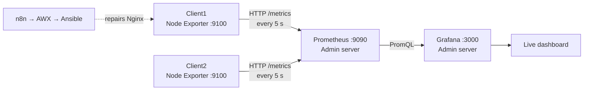

# 6. Monitoring with Node Exporter, Prometheus and Grafana

A live monitoring layer for the two Linux clients: CPU, memory, disk, uptime, host availability and the state of Nginx, with a stopped Nginx clearly visible on a dashboard.

> **Node Exporter makes the metrics available → Prometheus collects (scrapes) them → Grafana shows them.**



Monitoring *detects and shows* a problem. The separate n8n/AWX/Ansible path *repairs* it. After the repair, Node Exporter and Prometheus pick up the new state and Grafana turns green again.

| Machine | Role | Ports |
|---|---|---|
| Admin | Prometheus + Grafana | 9090, 3000 |
| Client1, Client2 | Node Exporter + Nginx | 9100, 80 |

## 1. Node Exporter (clients)
Installed on both clients with Ansible:
```bash
ansible clients -i inventory.ini -b -m apt -a 'name=prometheus-node-exporter state=present update_cache=yes'
```
Check: `systemctl is-active prometheus-node-exporter` and `sudo ss -ltnp | grep :9100`.

To monitor services such as Nginx, the **systemd collector** was enabled in `/etc/default/prometheus-node-exporter`:
```
ARGS="--collector.systemd"
```
then `sudo systemctl restart prometheus-node-exporter`. Metrics can be read directly without Grafana:
```bash
curl -s http://<client-ip>:9100/metrics | grep 'node_systemd_unit_state{name="nginx.service"'
```
For the `active` state, `1` means Nginx is active and `0` means it is not.

## 2. Prometheus (Admin)
```bash
sudo apt install prometheus -y && sudo systemctl enable --now prometheus
```
Scrape targets are configured in `/etc/prometheus/prometheus.yml`. See [`monitoring/prometheus-scrape-example.yml`](../monitoring/prometheus-scrape-example.yml). Validate before restarting:
```bash
promtool check config /etc/prometheus/prometheus.yml
sudo systemctl restart prometheus
curl -sG 'http://127.0.0.1:9090/api/v1/query' --data-urlencode 'query=up{job="linux_clients"}'   # 1 = target scraped, 0 = unreachable
```

## 3. Grafana (Admin)
Installed from the official Grafana APT repository (`sudo systemctl enable --now grafana-server`). Added Prometheus as a data source at `http://localhost:9090` (same host). Port 3000 should be allowed only from the administrator's own IP.

**Dashboard panels:** availability per client, Nginx state per client (`0` → red STOPPED, `1` → green RUNNING), CPU, memory and root-disk gauges, uptime, CPU and memory time series, and an Nginx state history graph. The dashboard refreshes every 5 seconds.

**Main PromQL queries**
```promql
# Nginx state (1 = active)
node_systemd_unit_state{job="linux_clients",client="Client1",name="nginx.service",state="active"}

# CPU usage %
100 * (1 - avg by (client) (rate(node_cpu_seconds_total{job="linux_clients",mode="idle"}[1m])))

# Memory usage %
100 * (1 - (node_memory_MemAvailable_bytes{job="linux_clients"} / node_memory_MemTotal_bytes{job="linux_clients"}))

# Root disk usage %
100 * (1 - (node_filesystem_avail_bytes{job="linux_clients",mountpoint="/",fstype!~"tmpfs|overlay"} / node_filesystem_size_bytes{job="linux_clients",mountpoint="/",fstype!~"tmpfs|overlay"}))

# Uptime (seconds)
time() - node_boot_time_seconds{job="linux_clients"}
```

## Changing the interval from 5 s to 2 s
Two separate settings: the Prometheus `scrape_interval` / `scrape_timeout` (how often data is collected) and the Grafana dashboard refresh (how often the screen redraws). Change both to `2s`, validate with `promtool`, and restart Prometheus.

## Live demo: stop and recover Nginx
```bash
systemctl is-active nginx          # healthy: Grafana shows RUNNING / green
sudo systemctl stop nginx          # within one scrape cycle Grafana shows STOPPED / red
curl -s http://<client-ip>:9100/metrics | grep 'node_systemd_unit_state{name="nginx.service",state="active"'   # raw metric is 0
sudo systemctl start nginx         # or recover with n8n -> AWX -> Ansible; Grafana turns green again
```

## Troubleshooting completed
- **Admin root disk 100% full.** The Prometheus install failed. Increased the EBS volume to 20 GiB, then expanded the partition and filesystem:
  ```bash
  lsblk
  sudo growpart /dev/nvme0n1 1
  sudo resize2fs /dev/nvme0n1p1
  sudo dpkg --configure -a
  sudo apt --fix-broken install -y
  ```
- **Grafana unstable on about 1 GiB RAM with no swap.** Added a 2 GiB swap file for the lab:
  ```bash
  sudo fallocate -l 2G /swapfile && sudo chmod 600 /swapfile
  sudo mkswap /swapfile && sudo swapon /swapfile
  echo '/swapfile none swap sw 0 0' | sudo tee -a /etc/fstab
  ```
  After a restart, port 3000 listened and the login page responded.

## Short Q&A
- **Does Grafana collect from Node Exporter?** No. Grafana queries Prometheus.
- **What if a client is unreachable?** Its `up` metric becomes `0`, so Grafana can show it offline.
- **Why Prometheus and not just curl?** curl is a manual spot check. Prometheus keeps the history over time and Grafana visualizes it.
